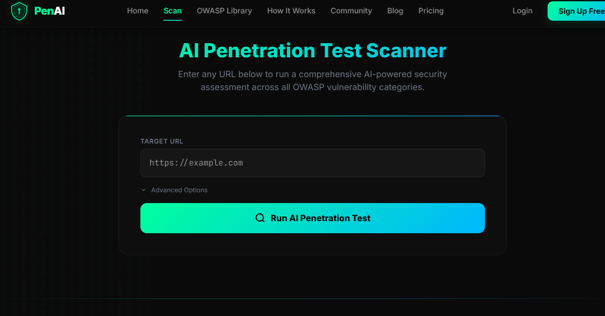

<div align="center">

# PenAI

### Find vulnerabilities. Understand the risk. Plan the fix.

A web application security workspace combining OWASP ZAP scanning, AI-assisted remediation, and shareable audit reports.


[](LICENSE)

[Get started](#get-started) · [Features](#features) · [Setup guide](docs/SETUP.md) · [API reference](docs/API.md) · [Contribute](CONTRIBUTING.md)

</div>

---

## Homepage preview

<p align="center">
  
</p>

*PenAI scanner screen captured from the project running locally. See the [setup guide](docs/SETUP.md) to run your own preview.*

## Overview

PenAI brings the security testing workflow into one dark, responsive interface: submit an authorized target, follow scan progress, review findings, request remediation guidance, and export the assessment.

The frontend runs without a build step. The Express API adds accounts and persistent scan history, OWASP ZAP supplies live security findings, and an optional Google Gemini integration generates explanations, suggested code fixes, and executive briefings.

> **Project status:** A development project with both a guest demonstration mode and a live scanning integration. Guest reports contain simulated findings. The interface also includes illustrative community and pricing sections; these are not connected community or billing services.

## Features

- **Live security scanning** — ZAP spider crawling, passive analysis, and active scanning, with progress updates in the browser.
- **Findings and prioritization** — Severity labels, affected URLs, remediation suggestions, and a custom score from 0 to 100.
- **AI-assisted remediation** — Vulnerability explanations, impact summaries, suggested code changes, and verification steps. Built-in guidance is available when Gemini is unavailable or unconfigured.
- **Executive briefings** — Assessment summaries, top priorities, and developer checklists.
- **Accounts and scan history** — Registration, login, JWT authentication, and user-specific scan records stored in MongoDB.
- **Report exports** — Download PDF audit reports or JSON data, and copy a report summary to the clipboard.
- **Security learning library** — Searchable OWASP Top 10 educational cards, examples, and prevention guidance.
- **Responsive interface** — A dark cyber theme, animated scan states, and layouts for desktop and mobile.

## Choose your mode

### Guest demonstration

Serve the frontend and use the scanner without signing in. Scan stages and findings are generated in the browser for demonstration; they do not establish whether the entered website is vulnerable. No API, database, ZAP daemon, or Gemini key is required.

### Live scanning

Start MongoDB, ZAP, and the backend, then register or sign in. Authenticated scan requests run through the API and are saved to your account. Gemini is optional; the backend provides fallback remediation guidance.

> Only scan applications you own or have explicit permission to test. ZAP active scans send attack payloads and can affect the target application.

## Get started

### Preview the frontend

```bash
git clone https://github.com/TORNADO984/PenAi-.git
cd PenAi-
python -m http.server 8000 --bind 127.0.0.1
```

Open [localhost:8000](http://localhost:8000). The frontend loads Tailwind CSS, fonts, and PDF libraries from external CDNs, so a full visual preview needs internet access.

### Run the complete application

1. Install Node.js 22 or newer and npm, and make a MongoDB instance available.
2. Start a ZAP daemon reachable at `127.0.0.1:8080` with an API key matching the backend configuration.
3. Open another terminal and configure the API from the repository root:

   ```bash
   cd penai-backend
   npm ci
   ```

   Copy `.env.example` to `.env` (`Copy-Item .env.example .env` in PowerShell, or `cp .env.example .env` in Bash). Set `MONGODB_URI` and a strong `JWT_SECRET`; configure the ZAP connection. Set `GEMINI_API_KEY` to your own key, or leave it empty to use fallback guidance.

4. Start the backend:

   ```bash
   npm start
   ```

5. Keep the frontend server running, open [localhost:8000](http://localhost:8000), create an account, and submit an authorized target.

The API defaults to [localhost:5000](http://localhost:5000). Frontend API URLs currently point to that address. See the [setup guide](docs/SETUP.md) for configuration, a Docker-based ZAP example, and troubleshooting.

## How it works

```text
Browser: HTML + Tailwind CSS + JavaScript
  |
  +-- Guest mode --> Browser-generated demonstration report
  |
  +-- Signed in --> Express API + JWT authentication
                      |
                      +-- MongoDB: accounts, scans, cached guidance
                      +-- OWASP ZAP: crawl, passive analysis, active scan
                      +-- Gemini (optional): remediation and briefings
```

The API creates a scan record and runs ZAP work in the background. The browser polls the scan endpoint for progress and results. Remediation guidance and executive summaries are requested through separate authenticated endpoints.

## Technology

- **Frontend:** HTML5, CSS, Tailwind CSS via CDN, and vanilla JavaScript.
- **Backend:** Node.js, Express, express-validator, and Axios.
- **Data and authentication:** MongoDB, Mongoose, bcryptjs, and JSON Web Tokens.
- **Scanning:** OWASP ZAP REST API and proxy integration.
- **AI:** Google Gen AI SDK, with `gemini-2.5-flash` configured in the service.
- **Reporting:** jsPDF and jsPDF-AutoTable in the browser.

## Repository layout

```text
.
|-- index.html                 # Frontend entry point
|-- css/style.css              # Theme and responsive styles
|-- js/
|   |-- app.js                 # Navigation, animations, and interface behavior
|   |-- auth.js                # Registration, login, and session UI
|   |-- scanner.js             # Scanning UI, reports, AI requests, and exports
|   `-- owasp-library.js       # Educational library data and rendering
|-- penai-backend/
|   |-- .env.example           # Backend configuration template
|   |-- server.js              # Express entry point
|   |-- config/                # MongoDB connection
|   |-- controllers/           # Authentication, scan, and AI handlers
|   |-- middleware/            # JWT checks and error handling
|   |-- models/                # User and Scan schemas
|   |-- routes/                # API route definitions
|   |-- services/              # ZAP and Gemini integrations
|   `-- utils/                 # JWT generation
|-- docs/
|   |-- SETUP.md               # Installation and troubleshooting
|   `-- API.md                 # Endpoints and request examples
`-- CONTRIBUTING.md            # Contributor workflow
```

## Current limitations

- Demo findings and live scan results share frontend report components. Some report content is generated from demo templates, including when a live result has no vulnerabilities. Check the API's stored scan record when validating results.
- The score is a custom deduction-based indicator, not a CVSS score or a certification of security. Automated findings and suggested fixes require review.
- Scans run inside the API process rather than a durable job queue. The shared ZAP service can stop active scans when another scan starts; use one live scan at a time in this setup.
- The frontend stores its token in `localStorage`, the API allows cross-origin requests, and target validation is not an authorization or network isolation control. Review these before exposing an installation publicly.
- When enabled, Gemini receives finding details and target information to generate guidance. Leave the key empty when that data must remain local.
- API authentication, MongoDB, and ZAP need their own deployment; static hosting alone provides the frontend demo.

## Documentation and contributions

Read the [setup guide](docs/SETUP.md), explore the [API reference](docs/API.md), or follow the [contribution guide](CONTRIBUTING.md) to help improve PenAI.

For reproducible bugs and feature requests, [open an issue](https://github.com/TORNADO984/PenAi-/issues). Do not include credentials, private target data, or sensitive scan reports.

## License

PenAI is released under the [MIT License](LICENSE). Copyright (c) 2026 TORNADO984.

---

<div align="center">

Built by [TORNADO984](https://github.com/TORNADO984) · [View the project](https://github.com/TORNADO984/PenAi-)

</div>
